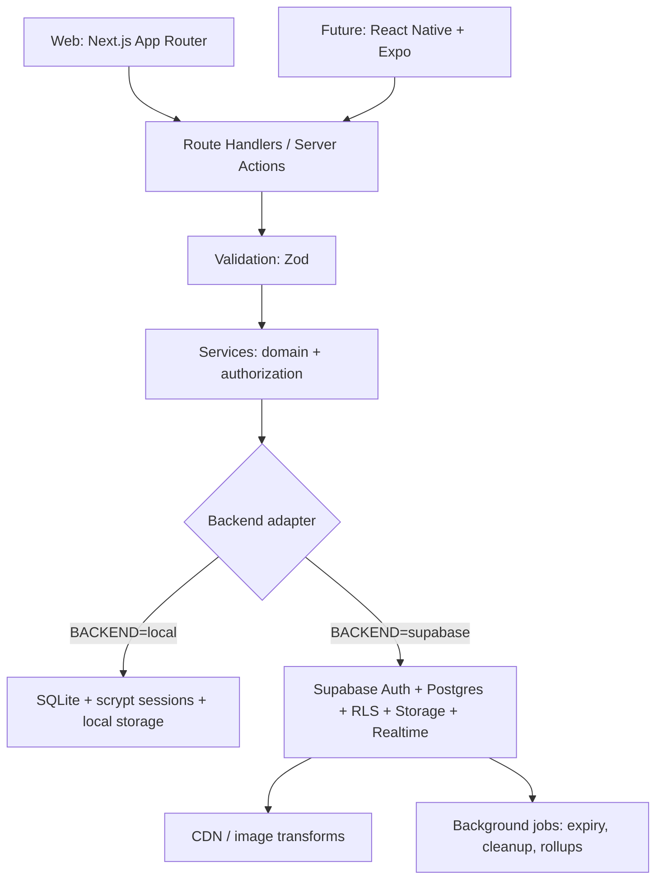

# REELO — System Architecture

**Version:** 2.0
**Source of truth:** `memory.md`

---

## 1. Current vs target

### 1.1 Current repository (audited 2026-11-21)

```
Next.js 14 App Router
  ├── UI pages + components (Natural Premium)
  ├── API route handlers
  │     └── hardcoded DEMO_CURRENT_USER
  ├── services/*.ts (fetch-based)
  └── lib/db (node:sqlite) ── data/reelo.db
        └── 12 demo tables, seeded content
```

Strengths: complete visual language, working UI flows, responsive shell, PWA manifest, Supabase scaffolding.

Gaps: demo auth, no multi-user isolation, no uploads, no admin authorization, no tests, no RLS enforcement in local mode.

### 1.2 Target architecture



Principles:
- UI never talks to the database directly.
- Route handlers are thin.
- Services own business rules and authorization.
- Adapters are swappable.
- Supabase is production; SQLite is development only.

---

## 2. Request lifecycle

```
Browser
  → middleware (session refresh / route guard)
  → page (Server Component) or /api route
  → parse + Zod validate
  → requireUser() / requireAdmin()
  → service function (business rules, block checks, transactions)
  → adapter (SQL / Supabase client)
  → response envelope { data } or { error }
  → UI render / optimistic reconciliation
```

Rules:
- `userId` always comes from the session, never from the request body.
- Unsafe methods verify `Origin` against `NEXT_PUBLIC_APP_URL`.
- Errors are mapped to stable codes; unexpected errors are logged with a request id.
- Mutations that affect counters run in a transaction.

---

## 3. Folder structure (target)

```text
app/
  (auth)/
    login/page.tsx
    signup/page.tsx
    forgot-password/page.tsx
  (main)/
    layout.tsx
    home/page.tsx
    explore/page.tsx
    create/page.tsx
    notifications/page.tsx
    saved/page.tsx
    profile/[username]/page.tsx
    settings/profile/page.tsx
    settings/privacy/page.tsx
    moderation/page.tsx
    admin/users/page.tsx
    admin/audit/page.tsx
  api/
    auth/{signup,login,logout,me}/route.ts
    profiles/[username]/route.ts
    settings/route.ts
    uploads/route.ts
    posts/route.ts
    posts/[id]/{route,like,comments,save}/route.ts
    comments/[id]/route.ts
    users/[username]/follow/route.ts
    search/route.ts
    notifications/route.ts
    blocks/route.ts
    reports/route.ts
    admin/reports/route.ts
    admin/users/route.ts
    admin/audit/route.ts
components/
  ui/            Button, Input, Card, Badge, Avatar, Modal, Tabs, Toast, Skeleton, EmptyState
  layout/        AppShell, Sidebar, MobileNav, Header, RightRail
  feed/          Composer, PostCard, CommentSheet, FeedTabs
  profile/       ProfileHeader, ProfileTabs, EditProfileForm, FollowButton
  moderation/    ReportDialog, BlockDialog, ReportQueue
  admin/         UserTable, AuditTable, StatCards
lib/
  backend/
    types.ts
    local/       db.ts, auth.ts, storage.ts
    supabase/    server.ts, client.ts, middleware.ts
  auth/          session.ts, password.ts, guards.ts
  config/        env.ts, features.ts
  validation/    auth.ts, profile.ts, post.ts, comment.ts, report.ts
  api/           response.ts, errors.ts, rate-limit.ts, pagination.ts
  utils/         cn.ts, dates.ts, media.ts, text.ts
services/
  authService.ts
  profileService.ts
  postService.ts
  feedService.ts
  commentService.ts
  followService.ts
  searchService.ts
  savedService.ts
  notificationService.ts
  moderationService.ts
  adminService.ts
  storageService.ts
types/
  database.ts
  domain.ts
  api.ts
supabase/
  migrations/
  policies/
scripts/
  init-local-db.js
  seed.js
  create-admin.js
docs/
```

---

## 4. Backend adapters

### 4.1 Interface (conceptual)

```ts
export interface Backend {
  auth: {
    signUp(input: SignUpInput): Promise<AuthResult>;
    signIn(input: SignInInput): Promise<AuthResult>;
    signOut(sessionId: string): Promise<void>;
    getSession(): Promise<SessionUser | null>;
  };
  db: {
    // domain-specific repositories, not raw SQL
    profiles: ProfileRepository;
    posts: PostRepository;
    // ...
  };
  storage: {
    upload(input: UploadInput): Promise<StoredFile>;
    remove(path: string): Promise<void>;
    signedUrl(path: string, ttlSeconds: number): Promise<string>;
  };
}
```

### 4.2 Local adapter (development)

- SQLite via `node:sqlite`; schema created by `scripts/init-local-db.js`.
- Auth: `scrypt` password hashes + `sessions` table + HttpOnly cookie.
- Storage: `public/uploads/{userId}/...` (gitignored) with a cleanup script.
- RLS is simulated in services; integration tests must cover the same rules.
- Never deploy the local adapter to production.

### 4.3 Supabase adapter (production)

- `@supabase/ssr` server client reads/writes cookies.
- Auth: Supabase email/password; `profiles` row created by trigger.
- Postgres RLS is the final authority; services still check permissions.
- Storage buckets + policies per `docs/database.md`.
- Realtime channels for Phase 3 notifications/messages.
- Service-role key used only in server-only admin/background jobs.

### 4.4 Switching

```bash
BACKEND=local      # no credentials needed
BACKEND=supabase   # requires URL + anon key + service role (server)
```

`lib/config/env.ts` validates required variables and fails fast in production.

---

## 5. Authentication design

### 5.1 Local

```
POST /api/auth/signup
  validate → hash(password) → transaction(profile, settings, credentials) → session

POST /api/auth/login
  find by email → constant-time verify → create session → Set-Cookie

Cookie: reelo_session=<32-byte hex>
  HttpOnly; SameSite=Lax; Path=/; Secure (prod); Max-Age=30d
```

- Session row stores `expires_at`; middleware rejects expired sessions.
- Password hash format: `scrypt$N$r$p$<salt>$<hash>`.
- Login errors are generic (no account enumeration).
- Rate limit: 5 attempts / 15 min per IP+email.

### 5.2 Supabase

- Supabase Auth handles credentials and sessions.
- Middleware refreshes the session.
- `profiles.id` references `auth.users.id`.
- A trigger creates `profiles` + `user_settings` on signup.

---

## 6. Feed architecture (MVP)

```
Following: posts where author in (select following_id from follows where follower_id = me)
           and deleted_at is null and visibility allows
           order by created_at desc, id desc
           cursor = (created_at, id)

Discover:  posts where not blocked/suspended/self
           score = (likes + 2*comments + 3*saves) / pow(hours+2, 1.5)
           then diversity cap: max 2 posts per author per page
```

Counters are denormalized on `posts`/`profiles` for read speed and updated transactionally.

---

## 7. Media architecture

```
Client → POST /api/uploads (multipart)
  → auth + rate limit
  → magic-byte + size + MIME validation
  → local disk OR Supabase Storage
  → metadata row / response
  → post creation references stored path
```

- Images: max 8 MB, resized variants (thumb 320, feed 1080).
- Video: max 100 MB, poster required; original not loaded in lists.
- Voice (Phase 3): private bucket + signed URLs.
- Cleanup job removes unreferenced objects after 24 h.

---

## 8. Configuration

| Variable | Required | Notes |
|---|---|---|
| `NEXT_PUBLIC_APP_URL` | yes | CSRF origin check, links |
| `BACKEND` | yes | `local` or `supabase` |
| `NEXT_PUBLIC_SUPABASE_URL` | supabase only | public |
| `NEXT_PUBLIC_SUPABASE_ANON_KEY` | supabase only | public |
| `SUPABASE_SERVICE_ROLE_KEY` | supabase only | server only |
| `ALLOW_DEMO_LOGIN` | no | dev only, default false |
| `SEED_DEMO_DATA` | no | dev only, default false |
| `MAX_IMAGE_MB` / `MAX_VIDEO_MB` | no | defaults 8 / 100 |
| `SESSION_DAYS` | no | default 30 |

Never commit `.env.local`. `.env.example` contains placeholders only.

---

## 9. Deployment

| Environment | Backend | Notes |
|---|---|---|
| Local | SQLite | `npm run dev`, no cloud needed |
| Preview | Supabase branch | migrations applied, seeded test data |
| Production | Supabase | RLS on, backups, monitoring |

Checklist: migrations applied → env set → storage buckets/policies → admin seeded → smoke test → DNS/TLS → monitoring.

---

## 10. Observability

- Structured JSON logs: `requestId`, `route`, `userId` (hashed), `latency`, `status`.
- Error tracking (Sentry or equivalent) with release tags.
- Metrics: request rate, p95 latency, error rate, DB pool, storage usage.
- Alerts: error rate > 2%, p95 > 1 s, report backlog > 50.
- Health endpoint: `/api/health` (DB + storage + version).

---

## 11. Performance budgets

| Surface | Budget |
|---|---|
| Feed API p95 | < 500 ms prod |
| Post detail p95 | < 300 ms |
| Upload (8 MB image) | < 5 s on 4G |
| LCP | < 2.5 s |
| CLS | < 0.1 |
| JS bundle (home) | < 250 KB gzip |

Techniques: server components, cursor pagination, image optimization, poster-first video, caching public profiles, DB indexes, no N+1 queries.

---

## 12. Mobile path (post-Phase 3)

- React Native + Expo, TypeScript.
- Reuse REST contracts and Supabase Auth.
- Shared types package (or generated from OpenAPI).
- Push notifications via Expo; deep links `reelo://`.
- No separate business logic fork.

---

## 13. Architectural risks

| Risk | Mitigation |
|---|---|
| Adapter drift (local vs Supabase) | Shared integration tests; same service contracts |
| SQLite-only bugs | CI runs Postgres tests |
| Media cost explosion | Limits + posters + transcoding phase |
| Realtime complexity | Phase 3; polling fallback |
| Premature microservices | Monolith first; extract only with evidence |
