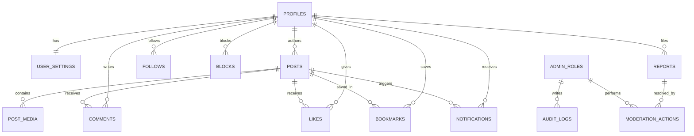

# REELO — Database Schema & Data Architecture

**Version:** 2.0
**Primary engine:** Cloud Supabase PostgreSQL 15+ (Auth, PostgreSQL, Storage, Realtime)
**Local PC Storage:** Decommissioned (User data, posts, and accounts are never stored on PC)
**Source of truth:** `memory.md`

> Migrations are additive and numbered. Never edit an applied migration. Every exposed table has RLS.

---

## 1. Conventions

| Rule | Detail |
|---|---|
| IDs | `uuid` default `gen_random_uuid()` (local adapter uses `TEXT`) |
| Timestamps | `timestamptz not null default now()` |
| Soft delete | `deleted_at timestamptz` on user content |
| Booleans | `boolean not null default false` |
| Enums | Postgres enums for finite states |
| FKs | Explicit `on delete` behavior |
| Counters | Updated in the same transaction as the source row |
| Indexes | Every FK, every `created_at desc`, every search column |
| Search | `tsvector` + GIN in Postgres; FTS5 in SQLite |
| Validation | DB constraints + Zod at the API boundary |

---

## 2. Entity relationship overview (Phase 1)



---

## 3. Phase 1 DDL (PostgreSQL)

### 3.1 Enums and helpers

```sql
create extension if not exists pgcrypto;
create extension if not exists pg_trgm;

create type profile_status   as enum ('active', 'suspended', 'deactivated', 'deleted');
create type post_kind        as enum ('post', 'reel', 'discussion');
create type post_visibility  as enum ('public', 'followers');
create type report_target    as enum ('post', 'comment', 'user');
create type report_status    as enum ('pending', 'reviewing', 'resolved', 'dismissed');
create type admin_role       as enum ('super_admin', 'moderator', 'support');
create type dm_policy        as enum ('everyone', 'followers', 'nobody');

create or replace function public.touch_updated_at()
returns trigger language plpgsql as $$
begin
  new.updated_at = now();
  return new;
end;
$$;

create or replace function public.is_admin()
returns boolean language sql stable security definer set search_path = public as $$
  select exists (select 1 from public.admin_roles where user_id = auth.uid());
$$;

create or replace function public.is_blocked(a uuid, b uuid)
returns boolean language sql stable security definer set search_path = public as $$
  select exists (
    select 1 from public.blocks
    where (blocker_id = a and blocked_id = b)
       or (blocker_id = b and blocked_id = a)
  );
$$;

create or replace function public.is_following(follower uuid, target uuid)
returns boolean language sql stable security definer set search_path = public as $$
  select exists (
    select 1 from public.follows
    where follower_id = follower and following_id = target
  );
$$;
```

### 3.2 Identity

```sql
create table public.profiles (
  id                uuid primary key references auth.users(id) on delete cascade,
  username          text not null unique check (username ~ '^[a-z0-9_]{3,24}$'),
  full_name         text not null check (char_length(full_name) between 1 and 50),
  bio               text check (char_length(bio) <= 300),
  avatar_url        text,
  cover_url         text,
  website           text check (website is null or website ~* '^https?://'),
  location          text check (char_length(location) <= 80),
  is_verified       boolean not null default false,
  status            profile_status not null default 'active',
  suspended_until   timestamptz,
  followers_count   integer not null default 0 check (followers_count >= 0),
  following_count   integer not null default 0 check (following_count >= 0),
  posts_count       integer not null default 0 check (posts_count >= 0),
  last_login_at     timestamptz,
  created_at        timestamptz not null default now(),
  updated_at        timestamptz not null default now()
);

create index profiles_status_idx      on public.profiles (status);
create index profiles_created_at_idx  on public.profiles (created_at desc);
create index profiles_username_trgm   on public.profiles using gin (username gin_trgm_ops);
create trigger profiles_touch before update on public.profiles
  for each row execute function public.touch_updated_at();

create table public.user_settings (
  user_id              uuid primary key references public.profiles(id) on delete cascade,
  is_private           boolean not null default false,
  who_can_dm           dm_policy not null default 'everyone',
  show_activity_status boolean not null default true,
  theme                text not null default 'light' check (theme in ('light', 'dark', 'system')),
  interests            text[] not null default '{}',
  created_at           timestamptz not null default now(),
  updated_at           timestamptz not null default now()
);
create trigger user_settings_touch before update on public.user_settings
  for each row execute function public.touch_updated_at();

-- Local adapter only (Supabase Auth owns credentials in production)
create table public.auth_credentials (
  user_id           uuid primary key references public.profiles(id) on delete cascade,
  email             text not null unique,
  password_hash     text not null,
  email_verified_at timestamptz,
  created_at        timestamptz not null default now()
);

create table public.sessions (
  id          text primary key,
  user_id     uuid not null references public.profiles(id) on delete cascade,
  expires_at  timestamptz not null,
  user_agent  text,
  ip_hash     text,
  created_at  timestamptz not null default now()
);
create index sessions_user_idx    on public.sessions (user_id);
create index sessions_expires_idx on public.sessions (expires_at);
```

### 3.3 Content

```sql
create table public.posts (
  id           uuid primary key default gen_random_uuid(),
  author_id    uuid not null references public.profiles(id) on delete cascade,
  kind         post_kind not null default 'post',
  content      text not null default '' check (char_length(content) <= 2000),
  visibility   post_visibility not null default 'public',
  community_id uuid, -- FK added in Phase 2
  search_text  tsvector generated always as (to_tsvector('simple', coalesce(content, ''))) stored,
  deleted_at   timestamptz,
  created_at   timestamptz not null default now(),
  updated_at   timestamptz not null default now(),
  check (char_length(content) > 0 or kind = 'reel')
);
create index posts_feed_idx    on public.posts (created_at desc, id desc) where deleted_at is null;
create index posts_author_idx  on public.posts (author_id, created_at desc) where deleted_at is null;
create index posts_search_idx  on public.posts using gin (search_text);
create trigger posts_touch before update on public.posts
  for each row execute function public.touch_updated_at();

create table public.post_media (
  id               uuid primary key default gen_random_uuid(),
  post_id          uuid not null references public.posts(id) on delete cascade,
  position         smallint not null default 0 check (position between 0 and 3),
  url              text not null,
  storage_path     text not null,
  mime             text not null,
  width            integer,
  height           integer,
  duration_seconds numeric(6,2),
  size_bytes       bigint not null check (size_bytes > 0),
  alt_text         text check (char_length(alt_text) <= 500),
  created_at       timestamptz not null default now(),
  unique (post_id, position)
);
create index post_media_post_idx on public.post_media (post_id, position);
```

### 3.4 Engagement & graph

```sql
create table public.likes (
  user_id    uuid not null references public.profiles(id) on delete cascade,
  post_id    uuid not null references public.posts(id) on delete cascade,
  created_at timestamptz not null default now(),
  primary key (user_id, post_id)
);
create index likes_post_idx on public.likes (post_id);

create table public.comments (
  id         uuid primary key default gen_random_uuid(),
  post_id    uuid not null references public.posts(id) on delete cascade,
  author_id  uuid not null references public.profiles(id) on delete cascade,
  parent_id  uuid references public.comments(id) on delete cascade,
  content    text not null check (char_length(content) between 1 and 1000),
  deleted_at timestamptz,
  created_at timestamptz not null default now(),
  updated_at timestamptz not null default now()
);
create index comments_post_idx   on public.comments (post_id, created_at) where deleted_at is null;
create index comments_author_idx on public.comments (author_id);

create table public.follows (
  follower_id  uuid not null references public.profiles(id) on delete cascade,
  following_id uuid not null references public.profiles(id) on delete cascade,
  created_at   timestamptz not null default now(),
  primary key (follower_id, following_id),
  check (follower_id <> following_id)
);
create index follows_following_idx on public.follows (following_id);

create table public.bookmarks (
  user_id    uuid not null references public.profiles(id) on delete cascade,
  post_id    uuid not null references public.posts(id) on delete cascade,
  created_at timestamptz not null default now(),
  primary key (user_id, post_id)
);
create index bookmarks_user_idx on public.bookmarks (user_id, created_at desc);

create table public.blocks (
  blocker_id uuid not null references public.profiles(id) on delete cascade,
  blocked_id uuid not null references public.profiles(id) on delete cascade,
  reason     text check (char_length(reason) <= 200),
  created_at timestamptz not null default now(),
  primary key (blocker_id, blocked_id),
  check (blocker_id <> blocked_id)
);
create index blocks_blocked_idx on public.blocks (blocked_id);
```

### 3.5 Notifications

```sql
create type notification_type as enum ('like', 'comment', 'follow', 'mention', 'repost');

create table public.notifications (
  id         uuid primary key default gen_random_uuid(),
  user_id    uuid not null references public.profiles(id) on delete cascade,
  actor_id   uuid not null references public.profiles(id) on delete cascade,
  type       notification_type not null,
  post_id    uuid references public.posts(id) on delete cascade,
  comment_id uuid references public.comments(id) on delete cascade,
  dedupe_key text not null unique,
  is_read    boolean not null default false,
  created_at timestamptz not null default now()
);
create index notifications_user_idx on public.notifications (user_id, created_at desc);
create index notifications_unread_idx on public.notifications (user_id) where is_read = false;
```

### 3.6 Moderation & admin

```sql
create table public.reports (
  id          uuid primary key default gen_random_uuid(),
  reporter_id uuid not null references public.profiles(id) on delete cascade,
  target_type report_target not null,
  target_id   uuid not null,
  reason      text not null check (reason in ('spam','harassment','hate_speech','misinformation','nudity','violence','other')),
  details     text check (char_length(details) <= 1000),
  snapshot    jsonb,
  status      report_status not null default 'pending',
  created_at  timestamptz not null default now(),
  resolved_at timestamptz,
  resolved_by uuid references public.profiles(id) on delete set null
);
create index reports_status_idx on public.reports (status, created_at desc);
create index reports_target_idx on public.reports (target_type, target_id);
create unique index reports_dedupe_idx on public.reports (reporter_id, target_type, target_id)
  where status in ('pending', 'reviewing');

create table public.moderation_actions (
  id           uuid primary key default gen_random_uuid(),
  report_id    uuid references public.reports(id) on delete set null,
  moderator_id uuid references public.profiles(id) on delete set null,
  action       text not null check (action in ('dismiss','remove_content','warn','suspend','restore')),
  target_type  report_target not null,
  target_id    uuid not null,
  notes        text check (char_length(notes) <= 1000),
  created_at   timestamptz not null default now()
);
create index moderation_actions_report_idx on public.moderation_actions (report_id);

create table public.admin_roles (
  user_id    uuid primary key references public.profiles(id) on delete cascade,
  role       admin_role not null default 'moderator',
  granted_by uuid references public.profiles(id) on delete set null,
  created_at timestamptz not null default now()
);

create table public.audit_logs (
  id          bigserial primary key,
  actor_id    uuid references public.profiles(id) on delete set null,
  action      text not null,
  target_type text not null,
  target_id   text not null,
  metadata    jsonb not null default '{}',
  created_at  timestamptz not null default now()
);
create index audit_logs_actor_idx  on public.audit_logs (actor_id, created_at desc);
create index audit_logs_target_idx on public.audit_logs (target_type, target_id);
```

---

## 4. Row Level Security (Phase 1)

```sql
alter table public.profiles            enable row level security;
alter table public.user_settings       enable row level security;
alter table public.auth_credentials    enable row level security;
alter table public.sessions            enable row level security;
alter table public.posts               enable row level security;
alter table public.post_media          enable row level security;
alter table public.likes               enable row level security;
alter table public.comments            enable row level security;
alter table public.follows             enable row level security;
alter table public.bookmarks           enable row level security;
alter table public.blocks              enable row level security;
alter table public.notifications       enable row level security;
alter table public.reports             enable row level security;
alter table public.moderation_actions  enable row level security;
alter table public.admin_roles         enable row level security;
alter table public.audit_logs          enable row level security;
```

### 4.1 Policy matrix

| Table | SELECT | INSERT | UPDATE | DELETE |
|---|---|---|---|---|
| `profiles` | active profiles; own row; admin | own id only (trigger) | own row; admin | service role |
| `user_settings` | own row | own row | own row | cascade |
| `auth_credentials` | own row | service role | own (password) | service role |
| `sessions` | own rows | own | own | own |
| `posts` | not deleted AND (public OR own OR follower OR admin) AND not blocked | own, active | own; admin | own (soft); admin |
| `post_media` | follows parent post visibility | owner of parent post | owner | owner |
| `likes` | own; post author; admin | own, active | — | own |
| `comments` | not deleted AND parent visible AND not blocked | own, parent visible | own | own; post owner; admin |
| `follows` | all (public graph) | own follower_id, not blocked | — | own |
| `bookmarks` | own | own | — | own |
| `blocks` | own | own | — | own |
| `notifications` | own | service role | own (is_read) | own |
| `reports` | own; admin | own | admin | service role |
| `moderation_actions` | admin | admin | — | — |
| `admin_roles` | own; admin | service role | service role | service role |
| `audit_logs` | admin | service role | — | — |

### 4.2 Example policies

```sql
-- Profiles
create policy "profiles_read" on public.profiles for select
  using (status = 'active' or id = auth.uid() or public.is_admin());

create policy "profiles_update_own" on public.profiles for update
  using (id = auth.uid()) with check (id = auth.uid());

-- Posts
create policy "posts_read" on public.posts for select
  using (
    deleted_at is null
    and not public.is_blocked(auth.uid(), author_id)
    and exists (
      select 1 from public.profiles p
      where p.id = author_id and (p.status = 'active' or public.is_admin())
    )
    and (
      visibility = 'public'
      or author_id = auth.uid()
      or public.is_following(auth.uid(), author_id)
      or public.is_admin()
    )
  );

create policy "posts_insert_own" on public.posts for insert
  with check (
    author_id = auth.uid()
    and exists (select 1 from public.profiles p where p.id = auth.uid() and p.status = 'active')
  );

create policy "posts_update_own" on public.posts for update
  using (author_id = auth.uid() or public.is_admin())
  with check (author_id = auth.uid() or public.is_admin());

-- Bookmarks
create policy "bookmarks_own" on public.bookmarks for all
  using (user_id = auth.uid()) with check (user_id = auth.uid());

-- Reports
create policy "reports_insert_own" on public.reports for insert
  with check (reporter_id = auth.uid());

create policy "reports_admin_read" on public.reports for select
  using (reporter_id = auth.uid() or public.is_admin());

-- Admin-only tables
create policy "moderation_admin" on public.moderation_actions for all
  using (public.is_admin()) with check (public.is_admin());

create policy "audit_admin_read" on public.audit_logs for select
  using (public.is_admin());
```

### 4.3 Storage policies

| Bucket | Read | Write | Limits |
|---|---|---|---|
| `avatars` | public | owner path `{uid}/**` | 5 MB, image only |
| `covers` | public | owner path `{uid}/**` | 10 MB, image only |
| `post-media` | public (MVP) | owner path `{uid}/**` | 8 MB image / 100 MB video |
| `voice` | members via signed URL | owner path `{uid}/**` | 10 MB, audio only |

```sql
-- Example: avatars owner write
create policy "avatars_owner_write" on storage.objects for insert
  with check (bucket_id = 'avatars' and (storage.foldername(name))[1] = auth.uid()::text);
```

---

## 5. Phase 2 tables

### 5.1 Stories

```sql
create table public.stories (
  id               uuid primary key default gen_random_uuid(),
  author_id        uuid not null references public.profiles(id) on delete cascade,
  media_url        text,
  media_type       text not null check (media_type in ('image','video','text')),
  text_overlay     text check (char_length(text_overlay) <= 300),
  background_color text,
  visibility       text not null default 'followers' check (visibility in ('public','followers','close_friends')),
  expires_at       timestamptz not null,
  created_at       timestamptz not null default now(),
  check (media_type <> 'text' or text_overlay is not null)
);
create index stories_author_idx  on public.stories (author_id, created_at desc);
create index stories_expires_idx on public.stories (expires_at);

create table public.story_views (
  story_id  uuid not null references public.stories(id) on delete cascade,
  viewer_id uuid not null references public.profiles(id) on delete cascade,
  viewed_at timestamptz not null default now(),
  primary key (story_id, viewer_id)
);

create table public.story_reactions (
  story_id   uuid not null references public.stories(id) on delete cascade,
  user_id    uuid not null references public.profiles(id) on delete cascade,
  emoji      text not null check (char_length(emoji) <= 8),
  created_at timestamptz not null default now(),
  primary key (story_id, user_id)
);

create table public.story_highlights (
  id         uuid primary key default gen_random_uuid(),
  owner_id   uuid not null references public.profiles(id) on delete cascade,
  title      text not null check (char_length(title) between 1 and 40),
  cover_url  text,
  created_at timestamptz not null default now()
);

create table public.highlight_items (
  highlight_id uuid not null references public.story_highlights(id) on delete cascade,
  story_id     uuid not null references public.stories(id) on delete cascade,
  position     smallint not null default 0,
  primary key (highlight_id, story_id)
);
```

### 5.2 Reels (view over posts)

```sql
create table public.reel_views (
  reel_id    uuid not null references public.posts(id) on delete cascade,
  viewer_id  uuid not null references public.profiles(id) on delete cascade,
  watched_ms integer not null default 0 check (watched_ms >= 0),
  created_at timestamptz not null default now(),
  primary key (reel_id, viewer_id)
);
-- Reels: posts.kind = 'reel'; one post_media video; poster in post_media.mime image.
```

### 5.3 Communities

```sql
create table public.communities (
  id           uuid primary key default gen_random_uuid(),
  owner_id     uuid not null references public.profiles(id) on delete cascade,
  name         text not null check (char_length(name) between 3 and 60),
  slug         text not null unique check (slug ~ '^[a-z0-9-]{3,60}$'),
  description  text not null check (char_length(description) <= 500),
  guidelines   text check (char_length(guidelines) <= 2000),
  avatar_url   text,
  cover_url    text,
  visibility   text not null default 'public' check (visibility in ('public','private')),
  category     text not null,
  members_count integer not null default 0,
  posts_count   integer not null default 0,
  created_at   timestamptz not null default now()
);
create index communities_slug_idx on public.communities (slug);
create index communities_category_idx on public.communities (category);

create table public.community_members (
  community_id uuid not null references public.communities(id) on delete cascade,
  user_id      uuid not null references public.profiles(id) on delete cascade,
  role         text not null default 'member' check (role in ('owner','moderator','member')),
  status       text not null default 'active' check (status in ('active','pending','banned')),
  joined_at    timestamptz not null default now(),
  primary key (community_id, user_id)
);
create index community_members_user_idx on public.community_members (user_id);

create table public.community_join_requests (
  id           uuid primary key default gen_random_uuid(),
  community_id uuid not null references public.communities(id) on delete cascade,
  user_id      uuid not null references public.profiles(id) on delete cascade,
  status       text not null default 'pending' check (status in ('pending','approved','rejected')),
  created_at   timestamptz not null default now(),
  unique (community_id, user_id)
);
```

### 5.4 Polls

```sql
create table public.polls (
  id              uuid primary key default gen_random_uuid(),
  post_id         uuid not null unique references public.posts(id) on delete cascade,
  question        text not null check (char_length(question) between 1 and 200),
  multiple_choice boolean not null default false,
  closes_at       timestamptz,
  created_at      timestamptz not null default now()
);

create table public.poll_options (
  id       uuid primary key default gen_random_uuid(),
  poll_id  uuid not null references public.polls(id) on delete cascade,
  label    text not null check (char_length(label) between 1 and 80),
  position smallint not null check (position between 0 and 5),
  unique (poll_id, position)
);

create table public.poll_votes (
  poll_id   uuid not null references public.polls(id) on delete cascade,
  option_id uuid not null references public.poll_options(id) on delete cascade,
  user_id   uuid not null references public.profiles(id) on delete cascade,
  created_at timestamptz not null default now(),
  primary key (poll_id, option_id, user_id)
);
-- Single-choice polls: enforce one row per (poll_id, user_id) in the service
-- transaction, or add a partial unique index driven by polls.multiple_choice.
```

### 5.5 Collections

```sql
create table public.collections (
  id         uuid primary key default gen_random_uuid(),
  owner_id   uuid not null references public.profiles(id) on delete cascade,
  name       text not null check (char_length(name) between 1 and 50),
  is_private boolean not null default true,
  created_at timestamptz not null default now(),
  unique (owner_id, name)
);

create table public.collection_items (
  collection_id uuid not null references public.collections(id) on delete cascade,
  post_id       uuid not null references public.posts(id) on delete cascade,
  added_at      timestamptz not null default now(),
  primary key (collection_id, post_id)
);
```

---

## 6. Phase 3 tables

```sql
create table public.conversations (
  id         uuid primary key default gen_random_uuid(),
  type       text not null default 'direct' check (type in ('direct','group')),
  name       text,
  avatar_url text,
  created_by uuid references public.profiles(id) on delete set null,
  created_at timestamptz not null default now()
);

create table public.conversation_members (
  conversation_id uuid not null references public.conversations(id) on delete cascade,
  user_id         uuid not null references public.profiles(id) on delete cascade,
  role            text not null default 'member' check (role in ('owner','admin','member')),
  status          text not null default 'accepted' check (status in ('pending','accepted','declined','left','banned')),
  last_read_at    timestamptz,
  joined_at       timestamptz not null default now(),
  primary key (conversation_id, user_id)
);
create index conversation_members_user_idx on public.conversation_members (user_id, status);

create table public.messages (
  id              uuid primary key default gen_random_uuid(),
  conversation_id uuid not null references public.conversations(id) on delete cascade,
  sender_id       uuid not null references public.profiles(id) on delete cascade,
  content_type    text not null default 'text' check (content_type in ('text','image','post','voice','system')),
  content         text check (char_length(content) <= 4000),
  media_url       text,
  media_path      text,
  duration_seconds numeric(6,2),
  waveform        jsonb,
  reply_to_id     uuid references public.messages(id) on delete set null,
  deleted_at      timestamptz,
  created_at      timestamptz not null default now()
);
create index messages_conversation_idx on public.messages (conversation_id, created_at desc) where deleted_at is null;

create table public.message_receipts (
  message_id   uuid not null references public.messages(id) on delete cascade,
  user_id      uuid not null references public.profiles(id) on delete cascade,
  delivered_at timestamptz,
  read_at      timestamptz,
  primary key (message_id, user_id)
);

create table public.message_requests (
  id           uuid primary key default gen_random_uuid(),
  from_user_id uuid not null references public.profiles(id) on delete cascade,
  to_user_id   uuid not null references public.profiles(id) on delete cascade,
  message_id   uuid references public.messages(id) on delete cascade,
  status       text not null default 'pending' check (status in ('pending','accepted','declined','blocked')),
  created_at   timestamptz not null default now(),
  unique (from_user_id, to_user_id)
);
```

---

## 7. Phase 4 tables

```sql
create table public.analytics_events (
  id          bigserial primary key,
  actor_id    uuid references public.profiles(id) on delete set null,
  event_type  text not null,
  target_type text,
  target_id   uuid,
  metadata    jsonb not null default '{}',
  created_at  timestamptz not null default now()
);
create index analytics_events_type_idx   on public.analytics_events (event_type, created_at desc);
create index analytics_events_actor_idx  on public.analytics_events (actor_id, created_at desc);
create index analytics_events_target_idx on public.analytics_events (target_type, target_id);

create table public.creator_stats_daily (
  creator_id      uuid not null references public.profiles(id) on delete cascade,
  day             date not null,
  profile_views   integer not null default 0,
  post_views      integer not null default 0,
  likes           integer not null default 0,
  comments        integer not null default 0,
  shares          integer not null default 0,
  saves           integer not null default 0,
  followers_gained integer not null default 0,
  followers_lost   integer not null default 0,
  primary key (creator_id, day)
);

create table public.events (
  id          uuid primary key default gen_random_uuid(),
  host_id     uuid not null references public.profiles(id) on delete cascade,
  title       text not null check (char_length(title) between 3 and 120),
  description text check (char_length(description) <= 2000),
  cover_url   text,
  starts_at   timestamptz not null,
  ends_at     timestamptz,
  timezone    text not null default 'UTC',
  mode        text not null default 'online' check (mode in ('online','offline')),
  location    text,
  online_url  text,
  capacity    integer check (capacity is null or capacity > 0),
  visibility  text not null default 'public' check (visibility in ('public','followers','invite')),
  created_at  timestamptz not null default now(),
  check (ends_at is null or ends_at > starts_at)
);

create table public.event_attendees (
  event_id   uuid not null references public.events(id) on delete cascade,
  user_id    uuid not null references public.profiles(id) on delete cascade,
  status     text not null default 'going' check (status in ('going','interested','declined')),
  created_at timestamptz not null default now(),
  primary key (event_id, user_id)
);

create table public.event_updates (
  id         uuid primary key default gen_random_uuid(),
  event_id   uuid not null references public.events(id) on delete cascade,
  body       text not null check (char_length(body) <= 1000),
  created_at timestamptz not null default now()
);

create table public.achievements (
  id          uuid primary key default gen_random_uuid(),
  code        text not null unique,
  name        text not null,
  description text not null,
  icon        text,
  category    text not null,
  criteria    jsonb not null default '{}',
  created_at  timestamptz not null default now()
);

create table public.user_badges (
  user_id        uuid not null references public.profiles(id) on delete cascade,
  achievement_id uuid not null references public.achievements(id) on delete cascade,
  awarded_at     timestamptz not null default now(),
  primary key (user_id, achievement_id)
);
```

---

## 8. Phase 5 tables

```sql
create table public.live_streams (
  id                 uuid primary key default gen_random_uuid(),
  host_id            uuid not null references public.profiles(id) on delete cascade,
  title              text not null,
  status             text not null default 'scheduled' check (status in ('scheduled','live','ended','canceled')),
  provider           text not null,
  provider_stream_id text,
  playback_url       text,
  started_at         timestamptz,
  ended_at           timestamptz,
  viewer_peak        integer not null default 0,
  replay_enabled     boolean not null default false,
  created_at         timestamptz not null default now()
);

create table public.live_viewers (
  stream_id uuid not null references public.live_streams(id) on delete cascade,
  user_id   uuid not null references public.profiles(id) on delete cascade,
  joined_at timestamptz not null default now(),
  left_at   timestamptz,
  primary key (stream_id, user_id, joined_at)
);

create table public.live_chat_messages (
  id         bigserial primary key,
  stream_id  uuid not null references public.live_streams(id) on delete cascade,
  user_id    uuid not null references public.profiles(id) on delete cascade,
  content    text not null check (char_length(content) <= 500),
  deleted_at timestamptz,
  created_at timestamptz not null default now()
);

create table public.moderation_appeals (
  id          uuid primary key default gen_random_uuid(),
  action_id   uuid not null references public.moderation_actions(id) on delete cascade,
  user_id     uuid not null references public.profiles(id) on delete cascade,
  reason      text not null,
  status      text not null default 'pending' check (status in ('pending','approved','rejected')),
  created_at  timestamptz not null default now(),
  reviewed_at timestamptz,
  reviewed_by uuid references public.profiles(id) on delete set null
);

create table public.platform_stats_daily (
  day             date primary key,
  dau             integer not null default 0,
  wau             integer not null default 0,
  mau             integer not null default 0,
  posts_created   integer not null default 0,
  reports_opened  integer not null default 0,
  reports_resolved integer not null default 0
);
```

---

## 9. Migration order

| Migration | Scope | Status |
|---|---|---|
| `001_initial_schema.sql` | Legacy demo schema | Exists — audit before reuse |
| `002_phase1_hardening.sql` | Phase 1 tables above + RLS | To create in P1.1 |
| `003_phase2_social.sql` | Stories, communities, polls, collections | Phase 2 |
| `004_phase3_messaging.sql` | Conversations, messages, requests | Phase 3 |
| `005_phase4_creator.sql` | Analytics, events, badges | Phase 4 |
| `006_phase5_live.sql` | Live, appeals, platform stats | Phase 5 |

Rules: one logical change per migration; include indexes and policies in the same migration as the table; write a rollback note in the header.

---

## 10. Local SQLite parity

| Postgres | SQLite (dev) |
|---|---|
| `uuid` | `TEXT` |
| `timestamptz` | `TEXT` ISO-8601 |
| `boolean` | `INTEGER 0/1` |
| `text[]` | JSON string |
| `jsonb` | JSON string |
| enums | `TEXT` + `CHECK` |
| RLS | Not available — enforce in services |
| `tsvector` | FTS5 virtual table |

The local adapter must pass the same integration tests as Supabase. If a rule cannot be enforced in SQLite, it must be enforced in the service layer and covered by a test.

---

## 11. Seed policy

- Demo data only when `SEED_DEMO_DATA=true` and `NODE_ENV !== 'production'`.
- Seed users have `@example.reelo` emails and no real credentials.
- Never seed admin roles automatically in production.
- First admin is created via a one-off script using `ADMIN_EMAIL`, then the env var is removed.
- Seeds must be idempotent (`insert ... on conflict do nothing`).

---

## 12. Maintenance jobs

| Job | Frequency | Purpose |
|---|---|---|
| Expire stories | Hourly | Delete/hide `expires_at < now()` |
| Purge soft-deleted content | Daily (30-day grace) | Remove rows + storage objects |
| Recompute counters | Daily | Repair drift |
| Analytics rollup | Hourly | Populate `creator_stats_daily` |
| Expire sessions | Daily | Delete expired sessions |
| Orphan media cleanup | Daily | Remove unreferenced storage objects |
